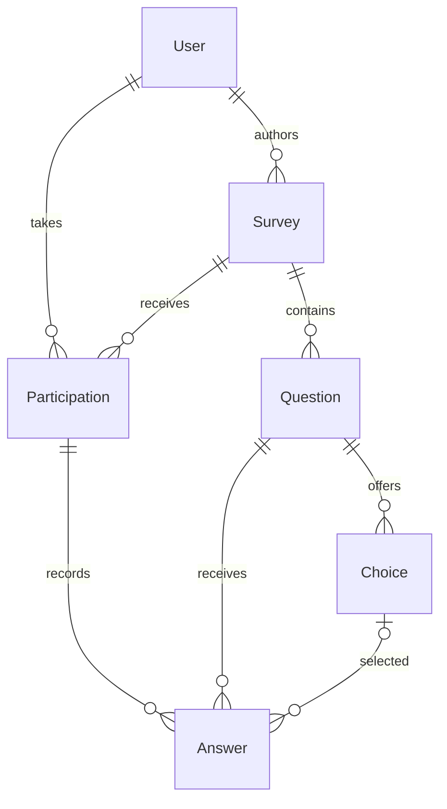

# UGC Surveys

Тестовое задание: пользователи создают опросы, задают порядок вопросов и вариантов,
проходят опросы с сохранением прогресса и получают статистику своих опросов.

Python 3.13 · Django 5.2 LTS · DRF 3.16 · PostgreSQL 17 · Uvicorn · uv · Docker Compose.
Точные версии Python-зависимостей находятся в `uv.lock`.

## Быстрый запуск

Нужны только Docker и Docker Compose. Все сервисы запускаются локально.

```sh
cp .env.example .env
# В .env замените DJANGO_SECRET_KEY и POSTGRES_PASSWORD.
# Секрет можно сгенерировать: openssl rand -hex 32
docker compose build
docker compose up -d db
docker compose run --rm web python manage.py migrate
docker compose run --rm web python manage.py seed_demo
docker compose up -d web
```

API доступен по `http://127.0.0.1:8000/api/v1/`. Команда `seed_demo` выведет ID
опроса «Овощи» и токены `demo_author` / `demo_respondent`. Ее можно повторять:
существующие записи и ответы она не сбрасывает. Токены выдаются только этой
локальной командой; регистрации, логина и восстановления пароля нет.

В запросах используется `Authorization: Token <token>`. Не публикуйте `.env`
и сгенерированные токены. Внешний доступ к API с токенами потребовал бы HTTPS;
Compose открывает HTTP только на loopback-интерфейсе компьютера.

Для остановки с сохранением данных:

```sh
docker compose down
```

Для запуска без Docker: установите Python 3.13 и uv 0.9.5+, выполните
`uv sync --locked`, укажите в `.env` адрес своей PostgreSQL (`DB_HOST`, `DB_PORT`),
затем `uv run --env-file .env python manage.py migrate` и
`uv run --env-file .env uvicorn config.asgi:application --lifespan off`.
PostgreSQL-контейнер Compose по умолчанию не публикует свой порт на хосте.

## Пример прохождения

Подставьте токены и ID, полученные из `seed_demo` и предыдущих ответов API.
`GET next-question` не создает прохождение; таймер начинается с `POST start`.

```sh
API=http://127.0.0.1:8000/api/v1
AUTHOR_TOKEN=token_from_seed_demo
USER_TOKEN=token_from_seed_demo
SURVEY_ID=1

curl -sS -H "Authorization: Token $USER_TOKEN" "$API/surveys/"
curl -sS -H "Authorization: Token $USER_TOKEN" "$API/surveys/$SURVEY_ID/next-question/"
curl -sS -X POST -H "Authorization: Token $USER_TOKEN" "$API/surveys/$SURVEY_ID/start/"
```

В ответе `start` поле `id` — ID прохождения. В ответе `next-question`
поле `question.id` — ID вопроса, `question.choices[].id` — ID вариантов.

```sh
PARTICIPATION_ID=1
QUESTION_ID=1
CHOICE_ID=1

curl -sS -X POST -H "Authorization: Token $USER_TOKEN" \
  -H 'Content-Type: application/json' \
  -d "{\"question\":$QUESTION_ID,\"choice\":$CHOICE_ID}" \
  "$API/participations/$PARTICIPATION_ID/answers/"

curl -sS -H "Authorization: Token $USER_TOKEN" "$API/surveys/$SURVEY_ID/next-question/"
```

Для собственного ответа вместо `choice` передайте `custom_text`, если у вопроса
включен `allow_custom_answer`. Подставьте ID текущего следующего вопроса:

```sh
QUESTION_ID=2
curl -sS -X POST -H "Authorization: Token $USER_TOKEN" \
  -H 'Content-Type: application/json' \
  -d "{\"question\":$QUESTION_ID,\"custom_text\":\"Только в салате\"}" \
  "$API/participations/$PARTICIPATION_ID/answers/"

curl -sS -H "Authorization: Token $USER_TOKEN" "$API/surveys/$SURVEY_ID/next-question/"
curl -sS -H "Authorization: Token $AUTHOR_TOKEN" "$API/surveys/$SURVEY_ID/statistics/"
```

После последнего ответа возвращаются `state: completed` и `question: null`.
Повтор одинакового ответа возвращает тот же ID с HTTP 200; первый прием — 201.
Попытка заменить принятый ответ или ответить вне очереди — 409.

## Авторский API

Все пути имеют префикс `/api/v1/`. Отсутствующий/неверный токен дает 401;
чужие закрытые данные — 404; неверный payload — 400; конфликт записи — 409.

| Метод | Путь | Назначение |
| --- | --- | --- |
| GET | `/users/me/` | Текущий пользователь |
| GET / POST | `/surveys/` | Видимые опросы / создание своего |
| GET | `/surveys/?mine=1` | Все свои опросы |
| GET / PATCH / DELETE | `/surveys/{id}/` | Опрос; правка/удаление доступны автору |
| GET / POST | `/surveys/{id}/questions/` | Авторский список / добавление вопроса |
| GET / PATCH / DELETE | `/surveys/{id}/questions/{qid}/` | Авторское управление вопросом |
| GET / POST | `/surveys/{id}/questions/{qid}/choices/` | Авторский список / добавление варианта |
| GET / PATCH / DELETE | `/surveys/{id}/questions/{qid}/choices/{cid}/` | Управление вариантом |
| POST | `/surveys/{id}/reorder-questions/` | `{"ids": [qid2, qid1, ...]}` |
| POST | `/surveys/{id}/questions/{qid}/reorder-choices/` | `{"ids": [cid2, cid1, ...]}` |
| POST | `/surveys/{id}/start/` | Создать/вернуть свое прохождение |
| GET | `/surveys/{id}/next-question/` | Следующий вопрос текущего пользователя |
| POST | `/participations/{id}/answers/` | Принять свой ответ |
| GET | `/surveys/{id}/statistics/` | Статистика для автора |

Создание: опрос `{"title":"Овощи"}`, вопрос
`{"text":"Любишь помидоры?","allow_custom_answer":true}`, вариант `{"text":"Да"}`.
Новые элементы добавляются в конец. Порядок меняется полным списком ID детей
родителя; дубли, посторонние и пропущенные ID запрещены. ID автора/родителей
берутся из пользователя и URL, входными данными их переопределить нельзя.

`is_published` — булево поле видимости, по умолчанию `false`.
Обычный `PATCH {"is_published":true}` делает опрос видимым. Отдельных статусов,
архивации и замораживания нет. После публикации можно править содержание и порядок.
Следующий вопрос определяется по текущему порядку с пропуском уже отвеченных ID.
Скрытый опрос доступен автору; после возврата видимости чужой прогресс сохраняется.

Один пользователь имеет одно прохождение опроса. Вопрос требует один вариант
либо собственный текст до 2000 символов; текст обрезается по краям, пустой запрещен.
Завершенные прохождения не открываются заново при добавлении вопросов.
Время завершения фиксируется только последним принятым ответом; если автор
удалил оставшиеся неотвеченные вопросы, API вернет `question: null`, а прохождение
сохранит исходное время начала без выдуманной даты завершения.

Ответы ссылаются на ID вопросов/вариантов. `PROTECT` запрещает удалить собранные
данные через удаление родителя: такой DELETE дает 409. История текстов не ведется;
переименование вопроса/варианта отражается и в статистике прежних ответов.

## Модели и организация кода



Модели: `User(AbstractUser)`, `Survey`, `Question`, `Choice`, `Participation`, `Answer`.
Одна модель на файл в `apps/<app>/models/`; сериализаторы и представления —
в `apps/<app>/api/serializers/` и `api/views/`. Используются ModelSerializer,
ModelViewSet, generic views и штатный TokenAuthentication DRF.

PostgreSQL обеспечивает уникальность позиций детей, пары пользователь/опрос,
пары прохождение/вопрос, положительные позиции и выбор одного типа ответа.
Межтабличные правила принадлежности проверяются транзакционной логикой API.
Перестановка выполняется атомарно с отложенными UNIQUE-ограничениями.
Авторские правки структуры блокируют Survey; ответ блокирует только Participation.
Конкурентное удаление выбранного варианта дает 409 с предложением перечитать опрос.

Статистика — SQL-агрегация исходных данных, без отдельной таблицы счетчиков:
старты, завершения, ответы, доля завершений, среднее время, распределение вариантов,
количество собственных ответов. Все лидеры при равенстве возвращаются вместе.
Среднее считается только по завершенным прохождениям и включает паузы;
при отсутствии завершений равно `null`. Статистика читает согласованный снимок
REPEATABLE READ, не выгружает свободные тексты и доступна только автору.

## Проверки

Тесты используют PostgreSQL; учетной записи БД нужно право создавать тестовую БД.
Для воспроизведения тестов в Docker (включая Ruff) создайте отдельный контейнер:

```sh
docker compose run --rm --user root web sh -c \
  'uv sync --locked && uv run ruff check . && uv run ruff format --check . && uv run python manage.py check && uv run python manage.py makemigrations --check --dry-run && uv run python manage.py test --noinput'
```

При установленном uv можно выполнить те же проверки на хосте с доступной PostgreSQL:

```sh
uv sync --locked
uv run ruff check .
uv run ruff format --check .
uv run --env-file .env python manage.py check
uv run --env-file .env python manage.py makemigrations --check --dry-run
uv run --env-file .env python manage.py test --noinput
```

CI запускает эти проверки с PostgreSQL service. Тесты покрывают права, ограничения
БД, прогресс, свободный текст, повторную отправку, статистику и конкурентные записи.
Проверка количества запросов защищает next-question и статистику от N+1.

## Нагрузка и границы решения

Из условий получается 15 млн вопросов, 75 млн вариантов, 75 млн прохождений
и до 1,125 млрд ответов. Это объем хранения; требуемый RPS из ТЗ неизвестен.
BigAutoField, составные индексы, cursor pagination без глобального COUNT,
`NOT EXISTS` по ответам одного прохождения и выборка вариантов одного вопроса
ограничивают объем работы запросов. Ответ не обновляет общий счетчик Survey.

Uvicorn выбран для HTTP ASGI API; Channels и Daphne здесь не нужны.
DRF/ORM остаются синхронными с короткими транзакциями. ASGI сам по себе
не доказывает ускорение. `CONN_MAX_AGE=0`; workers ограничены `WEB_CONCURRENCY`
(по умолчанию 1). Пулы, реплики, партиционирование и отдельные агрегаты
потребуют измерений на реальных данных. Особенно дорогой может стать статистика
одного очень популярного опроса. Нагрузочный тест на миллиарде строк не выполнялся.

Отдельного фронтенда, регистрации, внешних сервисов и продакшн-деплоя нет.
Архитектура и этапы реализации — в файле `plan`.
